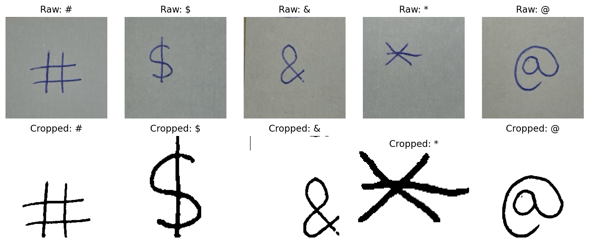
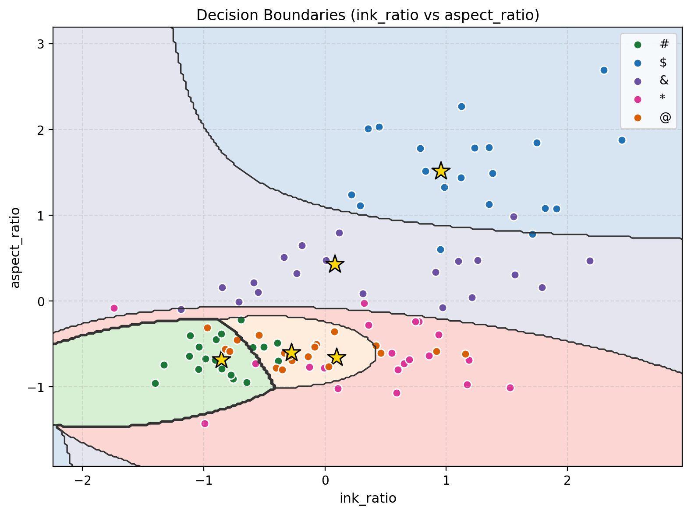
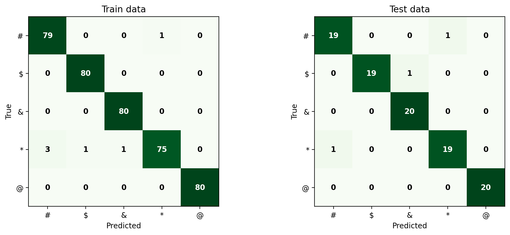
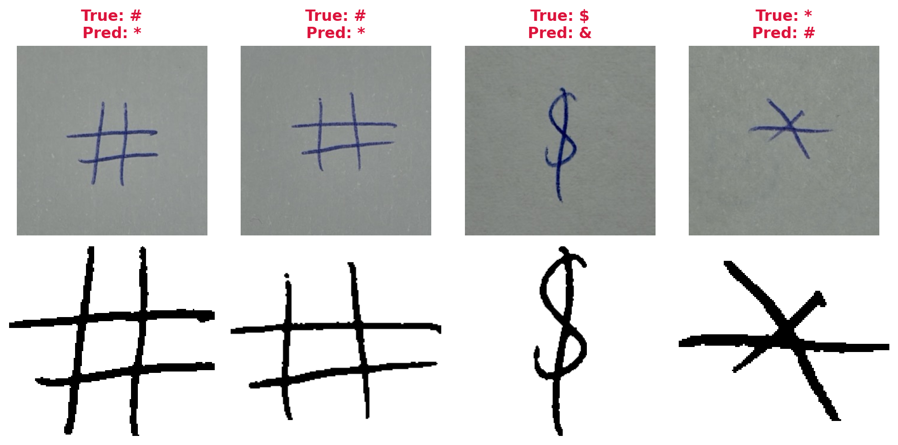

# Handwritten Special Characters Classification

A simple image classification project that recognizes five handwritten symbols: `#`, `$`, `&`, `*` and `@`. The images are cleaned and cropped, a few numbers (features) are measured on each symbol, and a Bayes classifier written in NumPy decides which symbol it is.

## How It Works

### 1. Preprocessing

| Step | What it does |
| :--- | :--- |
| Binarization | Turns the image into black and white using a threshold based on the brightest pixels |
| First crop | Removes the dark frame around the image |
| Median filter | Removes small noise using a 3x3 filter |
| Second crop | Removes the white margins so only the symbol is left |

### 2. Features

11 features are measured on every cropped symbol:

| Feature | Description |
| :--- | :--- |
| `centre` | Share of ink in the middle part of the image |
| `sym_horiz` | How symmetric the symbol is left to right |
| `sym_vert` | How symmetric the symbol is top to bottom |
| `crossings` | How many times the middle column goes from background to ink |
| `left`, `right` | Share of ink in the left and right edge strips |
| `top`, `bottom` | Share of ink in the top and bottom edge strips |
| `ink_ratio` | How much of the image is covered by ink |
| `euler` | Number of separate parts minus number of holes |
| `aspect_ratio` | Height divided by width |

### 3. Classification

- The data is split 80% train and 20% test for each class
- Features are standardized using the train set only
- A Bayes classifier with a separate Gaussian model for each symbol is used
- The code is written from scratch using only NumPy (no ready-made classifiers)

## Results

| Dataset | Accuracy |
| :--- | :---: |
| Train (80%) | 98.50% |
| Test (20%) | **97.00%** |

### Preprocessing (raw vs. cropped)

### Decision boundaries
Drawn for two features only (`ink_ratio` and `aspect_ratio`), so they only illustrate the idea and are not the boundaries of the full 11-feature classifier.

### Confusion matrices

### Misclassified examples

## Project Structure

| File / Folder | Description |
| :--- | :--- |
| `special_chars.py` | Preprocessing, feature extraction and classifier |
| `sample_images/` | Two example images per symbol (just for illustration) |
| `requirements.txt` | Python libraries needed |
| `README.md` | This file |

## How To Run

1. Install the libraries: `pip install -r requirements.txt`
2. Put the full dataset into a folder called `special chars jpeg/`, with one subfolder per symbol (`#`, `$`, `&`, `*`, `@`)
3. Run: `python special_chars.py`

The images in `sample_images/` are only examples. The full dataset is needed to run the classifier.
